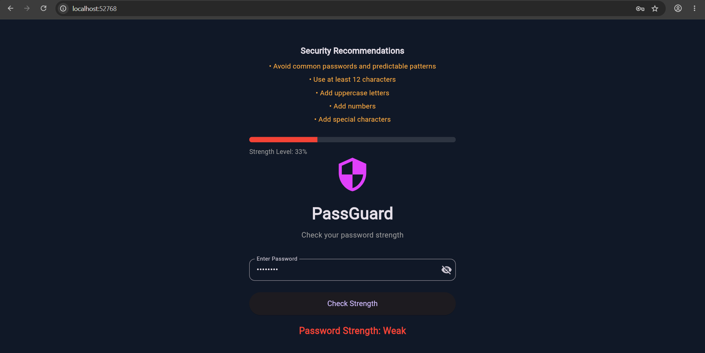
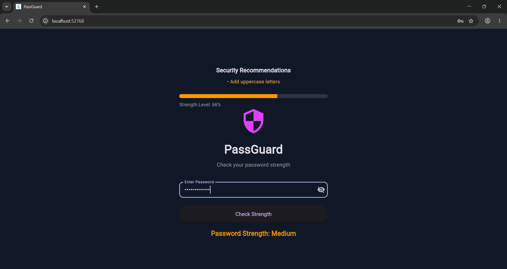
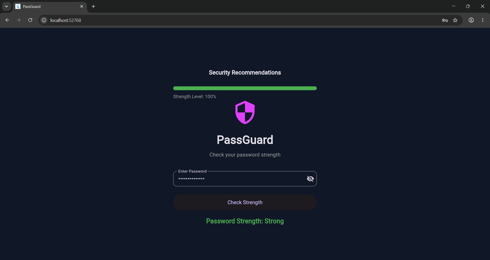

# passguard

A new Flutter project.

# PassGuard - Password Strength Checker 

PassGuard is a Flutter-based password strength checker developed using Dart.

The application helps users evaluate password strength and provides recommendations to improve password quality.

This project demonstrates Flutter development,Dart,programming, password validation, and automated testing.

## Features 

-Password strength classification (Weak,Medium,Strong)
-Animated password strength indicator 
-password visibility toggle
-Common password detection 
-Personalized security recommendations 
-Password length and character validation 
-Password length and character validation 
-Responsive dark-themed interface
-Automated unit and widget testing 

## Technologies Used 

-Flutter 
-Dart
-Material Design 3
-Regular Expressions (RegExp)
-Flutter Test 
-Git & GitHub 

## How It Works

PassGuard evaluates passwords using several basic checks:

1. Password length
2. Uppercase letters
3. Lowercase letters
4. Numeric characters
5. Special characters
6. Matches against a small list of common passwords

Based on these checks, the application displays
a password strength category.

The application also provides suggestions to help
users improve their passwords.

##  Testing

The project includes automated tests for:

- Empty password validation
- Common password detection
- Medium-strength password classification
- Strong-strength password classification
- Flutter UI components

Run all tests using:

```bash
flutter test
```

##  Installation

### Prerequisites

- Flutter SDK
- Dart SDK
- VS Code or Android Studio
- Git

### Clone the Repository

```bash
git clone https://github.com/ckaushalya368/PassGuard-.git
```

### Navigate to the Project

```bash
cd PassGuard-
```

### Install Dependencies

```bash
flutter pub get
```

### Run the Application

```bash
flutter run -d chrome
```

##  Project Structure

```text
lib/
├── main.dart
├── screens/
│   └── home_screen.dart
├── utils/
│   └── password_checker.dart
└── widgets/
    └── strength_indicator.dart

test/
├── password_checker_test.dart
└── widget_test.dart
```

##  Security Notice

PassGuard is an educational password strength estimator.

It is not a comprehensive password security auditing tool.

The displayed strength percentages represent visual
categories rather than actual password-cracking resistance.

Do not enter real passwords when testing the application.

##  Live Demo

🔗 [Try PassGuard](https://passguard-ee1d2.web.app/)

Deployed using Firebase Hosting.

##  Future Improvements

- Improved password strength estimation
- Expanded common-password detection
- Additional automated test cases
- Firebase Hosting deployment

## License


## 📸 Application Screenshots

### Weak Password


### Medium Password


### Strong Password

